

<!-- STUDIO 3D HERO BANNER (DARK & LIGHT ADAPTIVE) -->
<a href="https://my-portfolio-beta-bay-93.vercel.app/" target="_blank">
  <picture>
    <source media="(prefers-color-scheme: dark)" srcset="./assets/hero-banner-dark.png">
    <source media="(prefers-color-scheme: light)" srcset="./assets/hero-banner-light.png">
    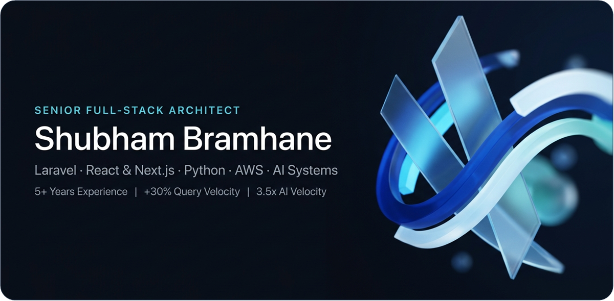
  </picture>
</a>

<!-- GLOWING HERO ACTION BAR (4-ACROSS RESPONSIVE) -->

  <a href="https://my-portfolio-beta-bay-93.vercel.app/" target="_blank">
    <picture>
      <source media="(prefers-color-scheme: dark)" srcset="./assets/cta-portfolio-dark.svg">
      <source media="(prefers-color-scheme: light)" srcset="./assets/cta-portfolio-light.svg">
      
    </picture>
  </a>
  <a href="https://my-portfolio-beta-bay-93.vercel.app/shubham_bramhane_resume.pdf" target="_blank">
    <picture>
      <source media="(prefers-color-scheme: dark)" srcset="./assets/cta-resume-dark.svg">
      <source media="(prefers-color-scheme: light)" srcset="./assets/cta-resume-light.svg">
      
    </picture>
  </a>
  <a href="https://www.linkedin.com/in/shubham1602/" target="_blank">
    <picture>
      <source media="(prefers-color-scheme: dark)" srcset="./assets/cta-linkedin-dark.svg">
      <source media="(prefers-color-scheme: light)" srcset="./assets/cta-linkedin-light.svg">
      
    </picture>
  </a>
  <a href="mailto:shubham.bramhane75@gmail.com">
    <picture>
      <source media="(prefers-color-scheme: dark)" srcset="./assets/cta-contact-dark.svg">
      <source media="(prefers-color-scheme: light)" srcset="./assets/cta-contact-light.svg">
      
    </picture>
  </a>

<!-- IMPACT KPI STRIP WITH MINI DATA VISUALIZATIONS -->
<picture>
  <source media="(prefers-color-scheme: dark)" srcset="./assets/metrics-dark.svg">
  <source media="(prefers-color-scheme: light)" srcset="./assets/metrics-light.svg">
  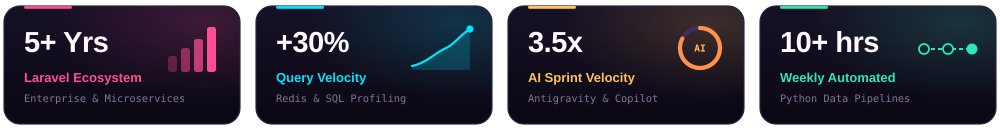
</picture>

  

<!-- ANIMATED SYSTEM ARCHITECTURE BLUEPRINT -->
<picture>
  <source media="(prefers-color-scheme: dark)" srcset="./assets/architecture-flow-dark.svg">
  <source media="(prefers-color-scheme: light)" srcset="./assets/architecture-flow-light.svg">
  
</picture>

  

<!-- 5-AXIS CAPABILITY RADAR & TECH STACK BENTO -->
<picture>
  <source media="(prefers-color-scheme: dark)" srcset="./assets/tech-stack-dark.svg">
  <source media="(prefers-color-scheme: light)" srcset="./assets/tech-stack-light.svg">
  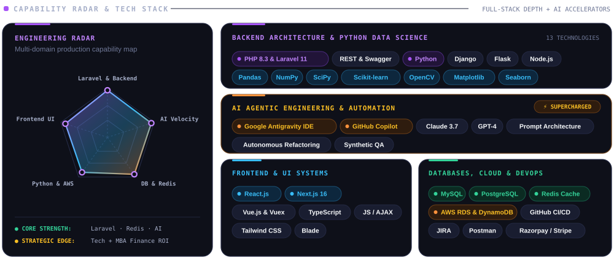
</picture>

  

<!-- FEATURED PRODUCTION CASE STUDIES (2x3 RESPONSIVE CLICKABLE GALLERY) -->
<picture>
  <source media="(prefers-color-scheme: dark)" srcset="./assets/projects-header-dark.svg">
  <source media="(prefers-color-scheme: light)" srcset="./assets/projects-header-light.svg">
  
</picture>

  <a href="https://oncquestlabs.com" target="_blank">
    <picture>
      <source media="(prefers-color-scheme: dark)" srcset="./assets/proj-oncquest-dark.svg">
      <source media="(prefers-color-scheme: light)" srcset="./assets/proj-oncquest-light.svg">
      
    </picture>
  </a>
  <a href="https://oncqfieldassist.oncquestlabs.com" target="_blank">
    <picture>
      <source media="(prefers-color-scheme: dark)" srcset="./assets/proj-fieldassist-dark.svg">
      <source media="(prefers-color-scheme: light)" srcset="./assets/proj-fieldassist-light.svg">
      
    </picture>
  </a>
   
  <a href="https://www.lalpathlabs.com" target="_blank">
    <picture>
      <source media="(prefers-color-scheme: dark)" srcset="./assets/proj-lalpath-dark.svg">
      <source media="(prefers-color-scheme: light)" srcset="./assets/proj-lalpath-light.svg">
      
    </picture>
  </a>
  <a href="https://bbtms.centumlearnpro.in" target="_blank">
    <picture>
      <source media="(prefers-color-scheme: dark)" srcset="./assets/proj-bigbasket-dark.svg">
      <source media="(prefers-color-scheme: light)" srcset="./assets/proj-bigbasket-light.svg">
      
    </picture>
  </a>
   
  <a href="https://magicalumbrella.com/" target="_blank">
    <picture>
      <source media="(prefers-color-scheme: dark)" srcset="./assets/proj-umbrella-dark.svg">
      <source media="(prefers-color-scheme: light)" srcset="./assets/proj-umbrella-light.svg">
      
    </picture>
  </a>
  <a href="https://my-portfolio-beta-bay-93.vercel.app/" target="_blank">
    <picture>
      <source media="(prefers-color-scheme: dark)" srcset="./assets/proj-portfolio-dark.svg">
      <source media="(prefers-color-scheme: light)" srcset="./assets/proj-portfolio-light.svg">
      
    </picture>
  </a>

 

<!-- OPEN-SOURCE PULSE & ENGINEERING ETHOS -->
<picture>
  <source media="(prefers-color-scheme: dark)" srcset="./assets/telemetry-dark.svg">
  <source media="(prefers-color-scheme: light)" srcset="./assets/telemetry-light.svg">
  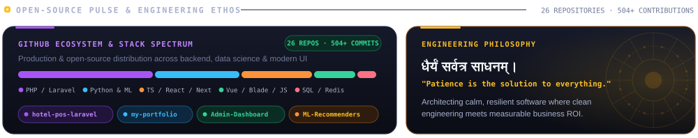
</picture>

  

<!-- CAREER JOURNEY & CREDENTIALS -->
<picture>
  <source media="(prefers-color-scheme: dark)" srcset="./assets/journey-dark.svg">
  <source media="(prefers-color-scheme: light)" srcset="./assets/journey-light.svg">
  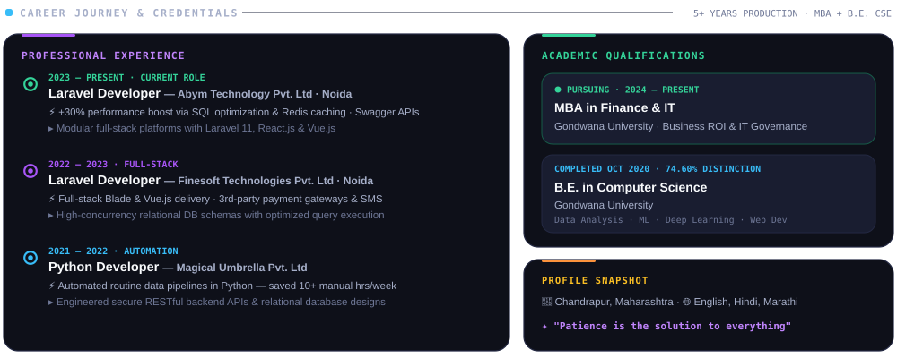
</picture>

  

<!-- INITIATE CONTACT & CONNECT (3x2 RESPONSIVE CLICKABLE GRID) -->
<picture>
  <source media="(prefers-color-scheme: dark)" srcset="./assets/connect-header-dark.svg">
  <source media="(prefers-color-scheme: light)" srcset="./assets/connect-header-light.svg">
  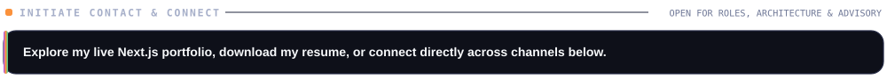
</picture>

  <a href="https://my-portfolio-beta-bay-93.vercel.app/" target="_blank">
    <picture>
      <source media="(prefers-color-scheme: dark)" srcset="./assets/card-portfolio-dark.svg">
      <source media="(prefers-color-scheme: light)" srcset="./assets/card-portfolio-light.svg">
      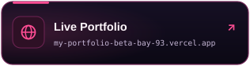
    </picture>
  </a>
  <a href="https://my-portfolio-beta-bay-93.vercel.app/shubham_bramhane_resume.pdf" target="_blank">
    <picture>
      <source media="(prefers-color-scheme: dark)" srcset="./assets/card-resume-dark.svg">
      <source media="(prefers-color-scheme: light)" srcset="./assets/card-resume-light.svg">
      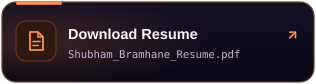
    </picture>
  </a>
  <a href="https://www.linkedin.com/in/shubham1602/" target="_blank">
    <picture>
      <source media="(prefers-color-scheme: dark)" srcset="./assets/card-linkedin-dark.svg">
      <source media="(prefers-color-scheme: light)" srcset="./assets/card-linkedin-light.svg">
      
    </picture>
  </a>
   
  <a href="mailto:shubham.bramhane75@gmail.com">
    <picture>
      <source media="(prefers-color-scheme: dark)" srcset="./assets/card-email-dark.svg">
      <source media="(prefers-color-scheme: light)" srcset="./assets/card-email-light.svg">
      
    </picture>
  </a>
  <a href="https://x.com/shubhbramhane16" target="_blank">
    <picture>
      <source media="(prefers-color-scheme: dark)" srcset="./assets/card-twitter-dark.svg">
      <source media="(prefers-color-scheme: light)" srcset="./assets/card-twitter-light.svg">
      
    </picture>
  </a>
  <a href="tel:+918857916707">
    <picture>
      <source media="(prefers-color-scheme: dark)" srcset="./assets/card-phone-dark.svg">
      <source media="(prefers-color-scheme: light)" srcset="./assets/card-phone-light.svg">
      
    </picture>
  </a>

 

<!-- ANIMATED FOOTER WAVE -->
<picture>
  <source media="(prefers-color-scheme: dark)" srcset="./assets/footer-dark.svg">
  <source media="(prefers-color-scheme: light)" srcset="./assets/footer-light.svg">
  
</picture>

 

Quick Plain-Text Profile &amp; Repository Documentation

### Shubham Bramhane — Senior Full-Stack Architect & AI-Augmented Engineer

Senior Full-Stack Engineer with 5+ years of production experience across the Laravel ecosystem, high-concurrency database architectures, pan-India healthcare portals, and Python data automation — pioneering agentic AI workflows with Google Antigravity, GitHub Copilot, and LLMs.

- **Experience:** Laravel Developer at Abym Technology Pvt. Ltd, Noida (2023–Present, +30% query velocity via SQL & Redis) · Laravel Developer at Finesoft Technologies Pvt. Ltd, Noida (2022–2023) · Python Developer at Magical Umbrella Pvt. Ltd (2021–2022, saved 10+ hrs/week)
- **Education:** Pursuing MBA in Finance & IT (2024–Present, Gondwana University) · B.E. in Computer Science (Oct 2020, 74.60% Distinction, Gondwana University — Data Analysis, ML, Deep Learning, Web Dev)
- **Tech Stack:** PHP 8.3, Laravel 11, Python (Pandas, NumPy, SciPy, Matplotlib, Seaborn, Scikit-learn, OpenCV), Django, Flask, Node.js, React.js, Next.js 16, Vue.js, TypeScript, Tailwind CSS, MySQL, PostgreSQL, Redis, AWS (RDS, DynamoDB), GitHub, JIRA, Google Antigravity, GitHub Copilot
- **Featured Platforms:** [Oncquest Healthcare](https://oncquestlabs.com) · [Oncquest Admin](https://admin.oncquestlabs.com/admin) · [OncqFieldAssist](https://oncqfieldassist.oncquestlabs.com) · [Lal Path Labs](https://www.lalpathlabs.com) · [Big Basket TMS](https://bbtms.centumlearnpro.in) · [Magical Umbrella](https://magicalumbrella.com/) · [Hotel POS (Laravel)](https://github.com/shubham-bramhane/hotel-pos-laravel)
- **Connect:** [Portfolio](https://my-portfolio-beta-bay-93.vercel.app/) · [Website](https://shubhambramhane.in) · [Resume PDF](https://my-portfolio-beta-bay-93.vercel.app/shubham_bramhane_resume.pdf) · [LinkedIn](https://www.linkedin.com/in/shubham1602/) · [X (@shubhbramhane16)](https://x.com/shubhbramhane16) · `shubham.bramhane75@gmail.com` · `+91-8857916707`

---

**Project Documentation & Shareable Overview**
- [Profile Overview PDF](./docs/shubham-bramhane-overview.pdf)
- [Product Requirements (PRD)](./docs/prd.md) · [Technical Requirements (TRD)](./docs/trd.md) · [Implementation Plan](./docs/implementation-plan.md) · [Testing Strategy](./docs/testing-strategy.md) · [Deployment Plan](./docs/deployment-plan.md)

